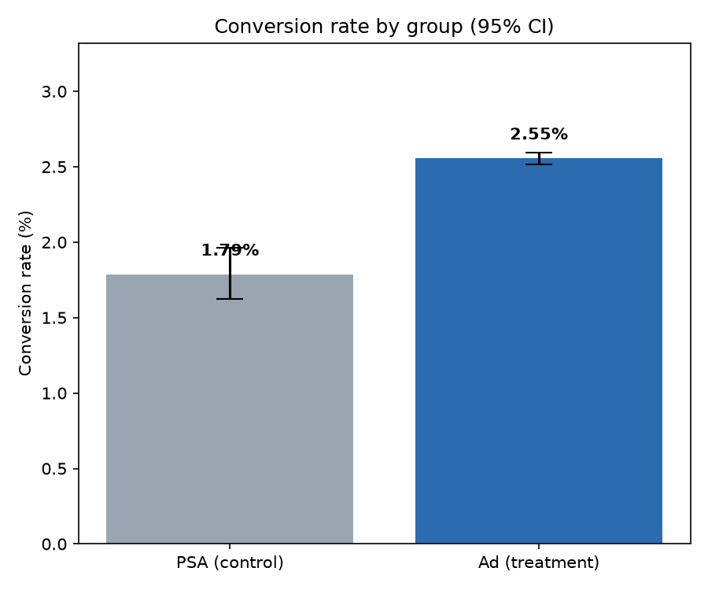
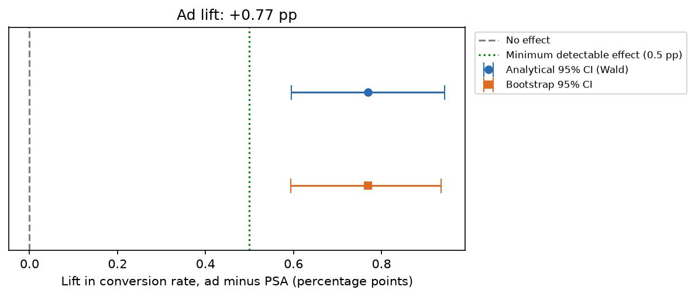
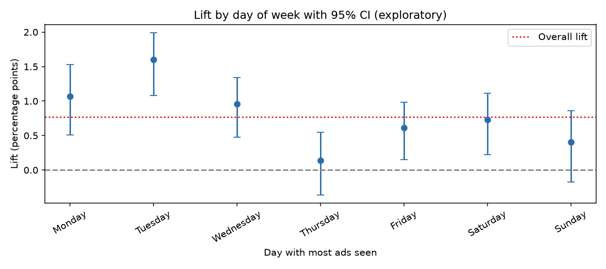
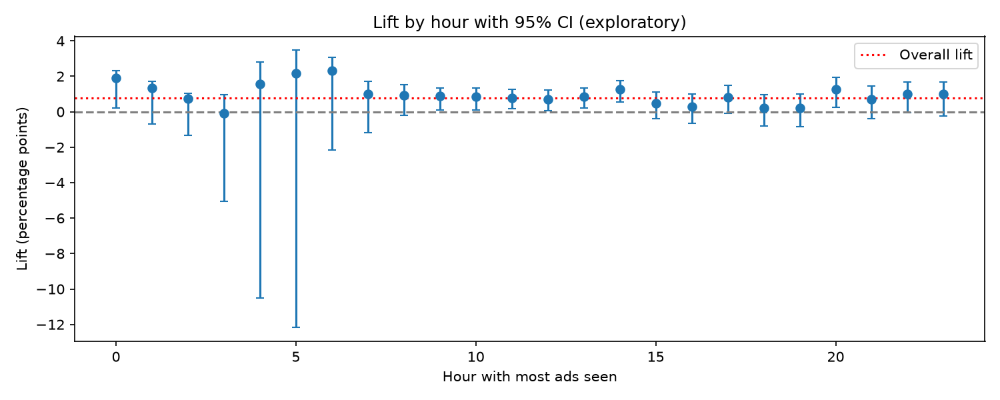
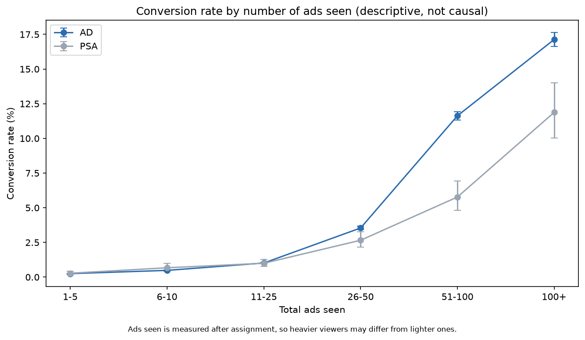

# Marketing A/B Test: Did the Ad Increase Conversion?

**Business question:** A marketing team wants to know whether showing the ad increases conversion compared with a public service announcement (PSA), so they can decide whether the campaign is worth the spend.

## Summary

**Recommendation: ship the ad.** Users shown the ad converted at **2.55%** vs. **1.79%** for users shown the PSA, a lift of **0.77 percentage points (95% CI 0.60 to 0.94)**, or a **43% relative increase**. The result is statistically significant (p < 0.0001), the whole interval sits above the 0.5 pp minimum effect the test was designed to detect, and the result holds after adjusting for day and hour. Under illustrative cost and value assumptions (see "Business impact"), the campaign stays profitable even at the low end of the interval.



## Data

- **Source:** Marketing A/B Testing dataset (Kaggle)
- **Size:** 588,101 users, with no duplicate user IDs and no missing values
- **Columns used:** `test_group` (ad or psa), `converted` (0/1), `total_ads`, `most_ads_day`, `most_ads_hour`
- **Groups:** 564,577 ad users (96.0%) and 23,524 PSA users (4.0%)

## Tools

Python, pandas, statsmodels, scipy, matplotlib

## Experiment Design

**Hypotheses**
- H0: the conversion rate is the same in the ad and PSA groups.
- H1: the conversion rates differ.

**Test choices:** two-sided test at alpha = 0.05. I used two-sided because the question is whether the ad performs differently from the PSA, not only whether it is better, and a one-sided test would halve the p-value and make significance easier to claim.

**Sample ratio check.** The split is very uneven (96% / 4%), so I tested whether it matches a planned 96/4 allocation. A chi-square goodness-of-fit test gives p = 0.9998, so the observed split is consistent with a designed 96/4 allocation. The dataset does not document the design, so this is an assumption. The check confirms the split looks intentional. It cannot confirm that users were randomly assigned.

**Sample size and power.** To detect a 0.5 percentage point lift over the PSA baseline (1.79%) with 80% power at alpha = 0.05:

| Allocation | PSA users needed | Ad users needed | Total |
|---|---|---|---|
| 50 / 50 | 12,474 | 12,474 | 24,948 |
| 96 / 4 (actual ratio) | 6,497 | 155,921 | 162,418 |

The experiment has 23,524 PSA users, about 3.6 times the 6,497 needed, so it is adequately powered for an effect of 0.5 pp or larger. The small PSA group is still the limiting factor for precision, especially in segment-level checks.

## Results

| Metric | Ad | PSA |
|---|---|---|
| Users | 564,577 | 23,524 |
| Conversion rate | 2.55% | 1.79% |

| Measure | Value |
|---|---|
| Absolute lift | +0.77 pp |
| 95% CI, analytical | +0.60 to +0.94 pp |
| 95% CI, bootstrap (5,000 resamples) | +0.59 to +0.94 pp |
| Relative lift | +43.1% |
| Two-proportion z-test | p = 1.7e-13 |
| Chi-square test of independence | p = 1.7e-13 |

The two tests agree, and the analytical and bootstrap intervals are nearly identical. With 588k users, even a small lift would produce a tiny p-value, so the effect size and its interval matter more than the p-value. Here the interval is also practically meaningful: its lower bound (0.60 pp) is above the 0.5 pp minimum detectable effect.



## Robustness Checks

### Adjusted analysis

A logistic regression of conversion on group, day, and hour (PSA as the reference) gives an **odds ratio of 1.44 for the ad (95% CI 1.31 to 1.59)**. This matches the unadjusted odds ratio (about 1.44), which is what we would expect if day and hour are balanced across the two groups. The main result is not driven by when users saw the ads.

### Segment checks (exploratory)

I planned two segment families before looking at the results: day of week (7 segments) and four hour blocks. P-values are adjusted across all 11 tests with the Benjamini-Hochberg method.

| Segment | Ad rate | PSA rate | Lift (pp) | 95% CI (pp) | Adjusted p |
|---|---|---|---|---|---|
| Monday | 3.32% | 2.26% | +1.07 | 0.51 to 1.53 | 0.0011 |
| Tuesday | 3.04% | 1.44% | +1.60 | 1.08 to 1.99 | < 0.0001 |
| Wednesday | 2.54% | 1.58% | +0.96 | 0.48 to 1.34 | 0.0010 |
| Thursday | 2.16% | 2.02% | +0.14 | -0.36 to 0.55 | 0.55 |
| Friday | 2.25% | 1.63% | +0.62 | 0.15 to 0.99 | 0.014 |
| Saturday | 2.13% | 1.40% | +0.73 | 0.22 to 1.12 | 0.010 |
| Sunday | 2.46% | 2.06% | +0.40 | -0.17 to 0.86 | 0.17 |
| Night (0-5) | 1.35% | 0.14% | +1.21 | 0.56 to 1.42 | 0.0071 |
| Morning (6-11) | 2.12% | 1.26% | +0.86 | 0.53 to 1.13 | < 0.0001 |
| Afternoon (12-17) | 2.77% | 2.02% | +0.75 | 0.46 to 1.01 | < 0.0001 |
| Evening (18-23) | 2.74% | 2.07% | +0.68 | 0.28 to 1.01 | 0.0025 |

- **The lift is positive in all 11 segments** and significant after correction in 9 of them. Thursday and Sunday are not significant, and their intervals include zero.
- **Tuesday stands out** (+1.60 pp) and Thursday is flat (+0.14 pp). This is suggestive, but I did not formally test whether the lift differs by day, and with 11 segments some spread is expected by chance. I would not target by day without a follow-up test.
- **Treat the night block with caution.** Its PSA group has 735 users and only 1 conversion, so the PSA rate (0.14%) and the lift are very unstable.





### Ad exposure (descriptive only)

| Ads seen | Ad rate | PSA rate | Ad users | PSA users |
|---|---|---|---|---|
| 1-5 | 0.25% | 0.28% | 169,962 | 7,861 |
| 6-10 | 0.49% | 0.67% | 79,537 | 3,415 |
| 11-25 | 1.02% | 1.00% | 163,135 | 6,112 |
| 26-50 | 3.54% | 2.66% | 85,740 | 3,273 |
| 51-100 | 11.63% | 5.77% | 44,149 | 1,853 |
| 100+ | 17.14% | 11.88% | 22,054 | 1,010 |

Conversion rises steeply with the number of ads seen in both groups, and the ad's advantage is concentrated among heavy-exposure users. **This is a descriptive pattern, not a causal one.** The number of ads seen is measured after assignment, and users who see more ads are probably more engaged to begin with. The ad could also change how many ads a user sees. Because of this, ad count was left out of the main test and the regression, and it should not be read as "more ads cause more conversions."



## Decision and Business Impact

**Recommendation: ship.** The ad beats the PSA by 0.77 pp (95% CI 0.60 to 0.94), the effect is far from zero, it exceeds the minimum effect the test was powered to detect, it is consistent across bootstrap and regression checks, and the lift is positive in every segment.

**Assumptions (illustrative, not from the dataset).** The data has no cost or revenue information, so these numbers are placeholders to show the logic. Replace them with real figures.

| Assumption | Value |
|---|---|
| Profit per conversion | $20 |
| Ad cost per user reached | $0.05 |
| Audience | 564,577 users (the size of the ad group) |
| Total ad cost | $28,229 |

**Break-even.** At these assumptions the ad pays for itself if it lifts conversion by at least **0.25 pp** ($0.05 / $20). Even the low end of the interval (0.60 pp) is more than double that.

| Scenario | Lift | Incremental conversions | Incremental profit | Net after ad cost |
|---|---|---|---|---|
| Low end of CI | +0.60 pp | about 3,360 | about $67,200 | about $39,000 |
| Observed | +0.77 pp | about 4,343 | about $86,900 | about $58,600 |
| High end of CI | +0.94 pp | about 5,326 | about $106,500 | about $78,300 |

*Incremental conversions = ad users x lift. Figures are rounded.*

**How sensitive is the answer?** At the low end of the interval, the ad still breaks even as long as a conversion is worth at least about **$8.40** (cost per user / low-end lift). If a conversion is worth less than that, or if the cost per user is much higher than assumed, the recommendation should be revisited.

**What would change the answer**
- **Real costs and values.** The conclusion depends on the cost per user and the profit per conversion, which are assumed here.
- **The baseline.** The comparison is ad vs. PSA, not ad vs. showing nothing. A PSA may itself have a cost or an effect, so the true gain over no ad could differ.
- **Segment spread.** The weak Thursday and Sunday results are not enough to change the decision, but they are worth a follow-up test.

**Suggested follow-up experiments:** a holdout group that sees no ad at all, and a test of different ad frequencies, since conversion appears concentrated among heavy viewers.

## Limitations

- The randomization process is not documented. The sample ratio check supports a planned 96/4 split, but it cannot prove random assignment.
- The groups are very unbalanced, so the small PSA group limits precision, especially within segments.
- The segment and exposure results are exploratory. The exposure analysis is not causal.
- There is no cost, revenue, or time period information, so the business case relies on assumed values.
- The comparison is against a PSA, not against no ad.
- This is a single experiment on one campaign, so the results may not generalize to other products or audiences.

## Repository Structure

```
├── data/
│   └── raw/            # marketing_AB.csv (not committed)
├── notebooks/
│   └── 01_ab_test.ipynb
├── images/             # charts used in this README
├── requirements.txt
└── README.md
```

## How to Reproduce

1. Download the Marketing A/B Testing dataset from Kaggle and place `marketing_AB.csv` in `data/raw/`.
2. Install dependencies: `pip install -r requirements.txt`
3. Run `notebooks/01_ab_test.ipynb` from top to bottom. The charts are saved to `images/`.

## Definition of Done

- [x] Hypotheses stated (H0 and H1)
- [x] Sample size and power calculation
- [x] Significance test and confidence interval
- [x] Checks: day/hour segments, group imbalance
- [x] Plain-language ship / don't-ship recommendation